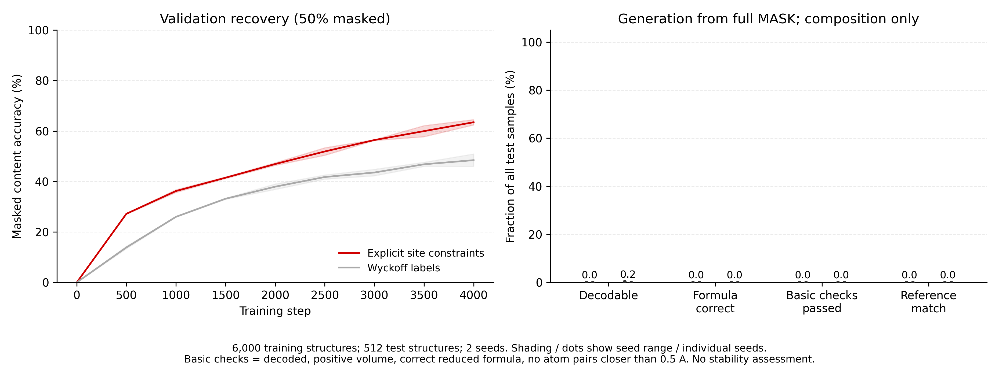

# 显式位点约束表示：仅组成条件的小模型试验

已完成两种表示、两个随机种子的正式训练与同一独立测试集评估。所有生成从固定 256 个 MASK 槽位开始，不提供真实空间群、晶胞原子数、位点数、序列长度或坐标。

## 结果

| 表示 | Seed | 50% 遮挡内容准确率 | 可解码 | 组成正确 | 基础检查通过 | 参考结构匹配 |
|---|---:|---:|---:|---:|---:|---:|
| Explicit site constraints | 17 | 66.4% | 0/512 (0.0%) | 0/512 (0.0%) | 0/512 (0.0%) | 0/512 (0.0%) |
| Explicit site constraints | 29 | 64.5% | 0/512 (0.0%) | 0/512 (0.0%) | 0/512 (0.0%) | 0/512 (0.0%) |
| Wyckoff labels | 17 | 52.4% | 2/512 (0.4%) | 0/512 (0.0%) | 0/512 (0.0%) | 0/512 (0.0%) |
| Wyckoff labels | 29 | 46.8% | 0/512 (0.0%) | 0/512 (0.0%) | 0/512 (0.0%) | 0/512 (0.0%) |

所有生成率分母均为 512，解码失败也计入。两次运行使用同一批测试组成，不能当成 1,024 个独立测试材料。

合计显式表示基础检查通过 0/1024；Wyckoff 对照 0/1024。

基础检查仅指：解码成功、有限正体积、约分组成正确、周期结构中不存在小于 0.5 Å 的原子间距。该阈值是宽松排错项，不代表化学合理性、稳定性或新材料发现。

参考匹配使用 StructureMatcher(ltol=0.2, stol=0.3, angle_tol=5, scale=False, primitive_cell=True, attempt_supercell=False)。同组成可以有多个晶型，未匹配原结构不等于错误。实际空间群用 spglib(symprec=1e-3 Å, angle_tolerance=-1) 重新识别，保存在每条记录中；没有把真实空间群用于投影或修复。

恢复准确率与全遮挡生成不同：前者能看到其余一半目标内容；后者只能看到组成。不同语法的 CE、token 准确率和数值误差不宜直接解释为表示优越性。

## 实际训练设置

- 模型：4 层双向 Transformer，宽度 192，6 heads，FFN 768；每个模型 2,357,727 个参数。
- 非自回归掩码去噪：随机遮挡 15%–100%，其中 25% 样本全遮挡；离散分类头与连续数值回归头共同训练。采样为 32 步并行置信度揭示。此处没有声称实现完整 D3PM 或连续坐标扩散模型。
- 条件：118 维元素整数配比约分后 log1p。输入 YbBPt₂ 与 Yb₂B₂Pt₄ 得到同一组成条件；不输入常规晶胞原子数。
- 数值槽位：晶格长度取 log、角度取 logit(angle/180)、自由坐标减 0.5、残差乘 1e4；与符号一起遮挡。表示本体仍是现有 SP1，未提出新 tokenizer。
- AdamW，学习率 3e-4，weight decay 0.01，batch 32，每次 4,000 步，seed 17/29。PAD 损失权重 0.1；不使用真实长度 attention mask。
- 每 500 步检查固定 50% 遮挡的验证损失；按 CE + 数值 MSE 选择 checkpoint。测试集在全部正式训练完成后首次加载。
- Burgundy 作业 580699，节点 gpu-a100-04，1 张 NVIDIA A100-SXM4-80GB、4 CPU。四次正式训练共 225.9 秒，不含预处理、模型加载、预检和评估。

## 数据与可逆性

- MP-20 固定数据版本 e8e9add5df904284116af8a06c203555d908f290。每个原始 split 按 material_id SHA256 排序，取 train 6000、val 512、test 512；ID 无交集。
- 常规晶胞先以六位分数坐标规范化，再由固定 Wyckoff 表重建理想对称结构。两种目标编码指向这同一个结构；这属于训练数据规范化，不是原始实验 CIF 的逐字无损重建。
- 配对数据覆盖：{"train": {"ok": 6000, "failed": 0, "overlength": 0}, "val": {"ok": 512, "failed": 0, "overlength": 0}, "test": {"ok": 512, "failed": 0, "overlength": 0}}；测试/验证未参与词表拟合，未出现未知 token。
- 平均训练序列长度：显式 55.08，Wyckoff 31.61；公共词表 1118。每个带类型连续数值槽位计一个位置。
- 7,024 个数据对均先通过两种 decoder 的结构往返验证；预检另做 64 次数值槽位打包/还原检查、全 MASK 目标替换检查、小批次过拟合、checkpoint 精确重载。详见 runs/preflight.json。

## 文件与复现

- PROTOCOL.md：训练前协议及用户指定组成条件的修订。
- data/records.jsonl：所有配对编码、canonical reference、条件与往返误差。data/selection.json：固定来源 hash 和 split ID。
- runs/{explicit,wyckoff}_{17,29}/best.pt：模型；config.json：参数和源码/数据 SHA256；curve.jsonl：学习曲线。
- generated.jsonl：所有完整预测文本，失败样本也保留。structure_metrics.jsonl：逐样本解码、组成、碰撞与匹配结果。samples/*.cif：解码成功的预测结构。
- results.json / pilot_results.png：汇总和图。compute_allocations/580699/finished/*/receipt.json：计算节点执行收据。
- 按 hpc/01_prepare.sh → hpc/02_train.sh → hpc/03_evaluate.sh 的顺序，在 Burgundy 分配到的节点内运行。不要在登录节点训练。

这轮是表示可学习性和组成条件生成的初步诊断，不能据此宣称显式表示具有新颖性、优于现有生成模型或已生成稳定材料。

## 生成失败后的诊断（不替换正式测试结果）

诊断仅使用训练集中的 8 个过拟合样本和验证集前 64 个材料，没有重新选择测试集 checkpoint。

| 模型与数据 | 采样步数 | 可解码 | 非 PAD token 准确率 |
|---|---:|---:|---:|
| runs/preflight.pt / train | 1 | 8/8 | 100.0% |
| runs/preflight.pt / train | 8 | 0/8 | 20.3% |
| runs/preflight.pt / train | 32 | 0/8 | 19.6% |
| runs/explicit_17/best.pt / val | 1 | 2/64 | 47.6% |
| runs/explicit_17/best.pt / val | 8 | 0/64 | 35.6% |
| runs/explicit_17/best.pt / val | 32 | 0/64 | 24.6% |
| runs/wyckoff_17/best.pt / val | 1 | 2/64 | 65.9% |
| runs/wyckoff_17/best.pt / val | 8 | 3/64 | 39.4% |
| runs/wyckoff_17/best.pt / val | 32 | 0/64 | 34.6% |

这些结果表明当前逐步揭示的采样过程会明显恶化输出，正式结果包含采样方案的失败，不能归因于表示本身。
8 样本预检只训练了全 MASK 输入，因此其多步采样是分布外诊断；正式模型训练过随机部分遮挡，但高置信度揭示产生的遮挡形态与随机遮挡仍不同。填充位置先被揭示、早期错误被冻结，是需要进一步验证的原因，尚未确证。
检查生成文本可见整数记录数被预测成数值槽、记录中间出现 PAD、生成元不构成合法整数矩阵等错误。固定 oracle 的单独检查用于排查采样索引和数值回填，见 sampler_bookkeeping_check.json；该 oracle 不参与正式模型或指标。
下一步优先改进与训练遮挡分布匹配的采样策略及符号类型约束，再评估条件生成；当前没有证据认为只给组成不成立，也没有证据证明显式表示优于 Wyckoff。
