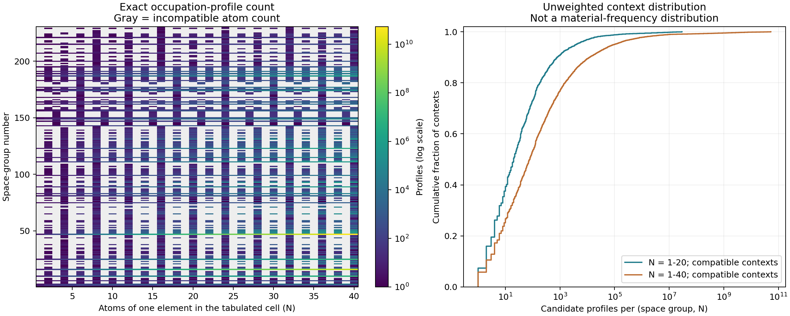

# 第一关结果：Wyckoff 单元素占位分配词表

2026-09-08，已在 Burgundy 的 Slurm 计算节点完成。

**结论：不建议直接建立全覆盖、每种完整占位分配独立成词的平坦词表。多数较小上下文可控，但组合规模存在极长尾。重数分拆作为上层 token 值得考察；能否减少实际学习难度，尚需第二关的真实数据分布和后续模型实验。**

## 实际计算成本

| 项目 | 实测 / 记录 |
|---|---|
| 成功作业 | `532545`，`COMPLETED`，退出码 `0:0` |
| 分区 / 节点 | `tiny / cpunode-057` |
| 申请资源 | 1 CPU、1 GiB 内存、15 分钟上限，0 GPU |
| Slurm 实际耗时 | 15 秒 |
| Python 全流程 | 14.23 秒，含读取、校验、计数、输出和绘图 |
| 计数段 | 0.040 秒 |
| CPU 时间 | Slurm TotalCPU 约 3.21 秒 |
| 峰值内存 | Python `getrusage` 记录 131.95 MiB，含绘图 |

Slurm 的周期采样 MaxRSS 为 29,888 KiB，短作业可能未采到峰值；报告采用进程自身记录的 131.95 MiB，不混用两种统计口径。所有科学计数、穷举校验和绘图都在计算节点执行，本地仅保存代码、传输文件和整理报告。

初次作业 `532542` 在读表时遇到 `2x` 的隐式乘法写法，未进入计数即退出；补齐解析后重提交。两个作业的日志均保留，没有将失败作业算作完成。

## 范围和计数含义

- 数据：官方 PyXtal **1.1.4** wheel 内的 230 个空间群、1731 个 Wyckoff 位置，源文件校验和已固定。
- 扫描：230 × 40 = **9,200** 个 `(空间群 G, 单元素原子数 N)` 上下文。
- N=1…40 是该空间群 **PyXtal 默认表格晶胞中的单元素原子数**，不是整个材料的原子总数，也不是最简化学式计数。菱方空间群采用表格默认六方设置。
- 每个候选记录该元素在各个有标签的 Wyckoff 位置上占据的独立 orbit 次数。零自由度位置最多一次，有自由度位置可重复，要求重数加权总和等于 N。
- 动态规划精确计算整数生成函数系数，不实际展开大候选列表，未设枚举截断或快速近似。
- 未对等价原点/晶胞设置取商，未检查多元素占位冲突、几何、稳定性；这里不是物理不等价晶体数。

## 核心结果

分位数只针对候选数大于零的上下文；采用经验最近秩分位数。

| 指标 | N=1…20 | N=1…40 |
|---|---:|---:|
| 检查上下文数 | 4,600 | 9,200 |
| 至少有一个候选 | 2,131 | 4,306 |
| 计数不相容，候选为 0 | 2,469 | 4,894 |
| 候选数中位数 | 20 | 78 |
| 第 90 百分位 | 776 | 12,072 |
| 第 95 百分位 | 3,854 | 95,130 |
| 第 99 百分位 | 151,038 | 10,962,528 |
| 最大候选数 | 29,428,536 | 52,979,534,432 |
| 可行上下文中候选 ≤1,000 的比例 | 90.76% | 76.73% |
| 候选超过 100 万的上下文数 | 13 | 93 |

**这些比例给每个 `(G,N)` 同等权重，不是材料出现频率。不能解读为“90.76% 的 MP-20 材料可以高效编码”。** 当前实验没有使用 MP-20 结构数据；其中 N≤20 的列也不是 MP-20 性能结果。

热图灰色表示该 N 与对应群的单元素重数组合不相容；并不表示该空间群没有晶体。右图显示可行上下文下的候选数长尾。

## 最大案例与原因

| 空间群 | 单元素 N | 完整有标签占位分配 | 去掉具体位点标签后的重数分拆 |
|---|---:|---:|---:|
| 47，Pmmm | 20 | 29,428,536 | 42 |
| 47，Pmmm | 40 | 52,979,534,432 | 146 |
| 16，P222 | 20 | 13,464,766 | 24 |

Pmmm 的数据表包含 8 个重数为 1 的固定位置，以及 12 个重数为 2、6 个重数为 4、1 个重数为 8 的可重复位置。其生成函数为：

`F_47(x) = (1+x)^8 / [(1-x^2)^12 (1-x^4)^6 (1-x^8)]`。

很多具体位点拥有相同重数，使得同一种原子数分拆对应大量不同的 Wyckoff 占位分配。这是词表膨胀的来源之一，不是对重复 orbit 的排列进行了重复计数。

全部 9,200 个上下文中，重数分拆数量最大为 **680**，出现在 `G=183, P6mm, N=40`。它是另一个上下文，不能拿 680 直接与 Pmmm 的最大完整分配数相除。

## 对 tokenizer 的影响

1. **“全部完整分配各占一个独立 token ID”不宜直接训练。** 即使限制 N≤20，最坏单上下文也已有约 2,943 万个类别。N≤40 的最坏情形约 530 亿个类别。不能只根据中位数较小判断全覆盖方案可行。
2. **分层有明确的规模动机。** Pmmm、N=40 的完整分配数是 52,979,534,432，而重数分拆只有 146。可以研究上层预测重数分拆，下层分别恢复具体 Wyckoff 身份。
3. **分层并未消灭结构信息。** 如果下层仍将所有完整位点组合列成一个巨型类别表，组合问题还在；下层需要按位点/计数分解，或使用结构化候选表示。
4. **不能仅凭这一关否定受限词表。** 数据中实际遇到的 G、N、orbit 数可能有很不同的分布。限定 orbit 数、对等价表示去重，或只在小候选上下文使用整块 token，都可能改变成本，但本轮未运行这些扩展。
5. **不证明性能与创新。** 本轮只回答候选规模和实现正确性。没有训练模型，没有验证条件满足率提升、生成新颖性或材料稳定性。

下一步若继续，应进行原定第二关：使用真实材料，检查高候选上下文的实际出现频率、每元素占据 orbit 数，以及相同编码精度下的分层成本。当前未自动启动第二关。

## 校验与可复现性

- 全部 230 个群在 N=1…6 的 **1,380** 个上下文中，动态规划与独立递归穷举完全一致，共比较 **21,431** 个候选。重数分拆计数也与穷举去重结果一致。
- **1,731** 个 Wyckoff 坐标映射的有理数矩阵秩与 NumPy 数值矩阵秩一致。
- P1、P-1 闭式结果和 Fm-3m 的 N=4、N=8 边界案例通过。
- 回传 CSV 含 9,200 个不同上下文；本地代码 SHA-256 与成功作业记录一致。
- 执行代码 SHA-256：`c94551b4c5e3b1753804092e288657425358e49c90b4385d95cfa48a979b3552`。

结果和复现文件：

- `results/summary.json`：精确统计、环境、资源、校验记录。
- `results/counts.csv`：全部 9,200 个上下文。
- `results/wyckoff_metadata.csv`：1731 个位置的重数与自由度。
- `count_vocab.py`、`run.slurm`：执行代码与资源配置。
- `input/provenance.json`：数据来源与 SHA-256。
- `slurm_accounting.txt`、`logs/`：集群执行记录。
- 远程目录：`/scratch/chenggui2/CrystalDLM/gate1_20260908`。

方法来源：[PyXtal 数据与组合接口](https://pyxtal.readthedocs.io/en/latest/_modules/pyxtal/symmetry.html)、[PyXtal 1.1.4](https://pypi.org/project/pyxtal/1.1.4/)、[WyckoffDiff §3.1 的占位表示](https://arxiv.org/html/2502.06485v4)。动态规划和本轮结果由本实验产生；报告由 AI 辅助编写。
